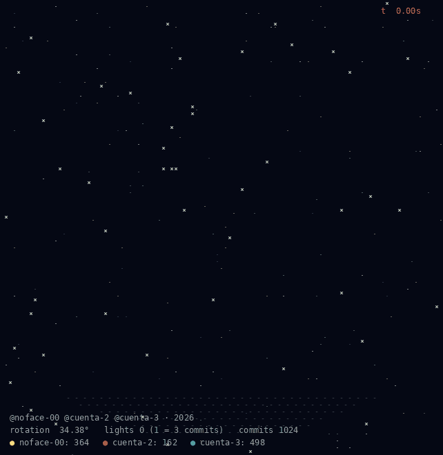

<h1 align="center">Hey, I'm Kevin 👋</h1>
<h3 align="center">Full-stack developer & business owner · Cuenca, Ecuador 🇪🇨</h3>

  Building <b>MORA</b> — workshop management, parts distribution, and the infrastructure that ties it all together.

  
   
  Every light is one day of activity — older at the bottom, recent at the top. More commits, brighter light.

---

## 🧑‍💻 About me

- 🛠️ I design and maintain **MORA**, a suite of business apps for an industrial workshop and a parts distributor.
- 🧩 Currently refactoring **CarMora** into clean *Operación / Catálogos / Configuración* modules.
- 🎓 Software Engineering student.
- 🐧 Daily driver: **macOS** and **Arch Linux** with **Hyprland** (Omarchy) — tiling WM, dark themes, clean terminals.
- 📝 Notes and academic writing in **Obsidian**, with a LaTeX / pandoc pipeline for papers.
- 📫 [morakevin269@gmail.com](mailto:morakevin269@gmail.com)

---

## 🧱 The MORA ecosystem

| Project | What it does | Stack |
|---|---|---|
| **CarMora** | Workshop management system (monorepo) | NestJS · Prisma · PostgreSQL · Expo |
| **CarMora Seals** | Hydraulic seals & John Deere parts distributor app | Expo · Supabase |
| **AppSy** | Multi-tenant manager: centralizes Google OAuth and routes shared microservices | NestJS · OAuth2 |
| **ServFacGmail** | Gmail invoice scanner for SRI Ecuador e-invoices, with Gemini as fallback | NestJS · Gmail API · Gemini |

> 🔒 Most of these are private business repos — happy to walk through the architecture if you ask.

---

## 🛠️ Stack

  
  
  
  
  
  
  
  
  
  
  
  

---

  

  <i>"La simplicidad es la máxima sofisticación." — Leonardo da Vinci</i>

