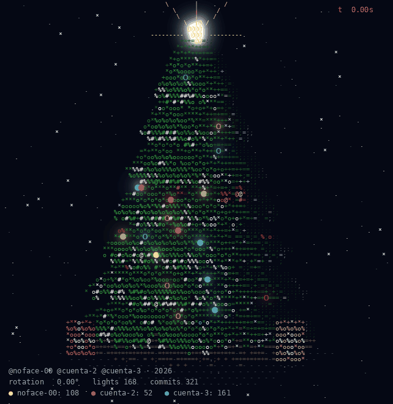
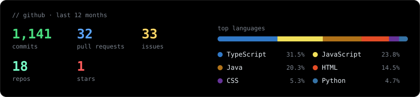

<!-- Todo lo visual se genera con la GitHub Action y vive en la rama `output` -->

  

  
   
  One light per commit — the more I ship, the brighter the tree gets.

  

  
   
  🔒 Most of these are private business repos — happy to walk through the architecture if you ask.

  

  

  
  

  

